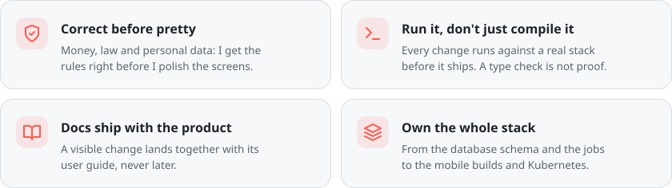
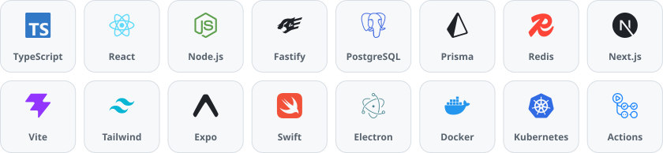

  

  &nbsp;
  &nbsp;
  

## About me

I'm **Christian Da Silva Perez**, a full-stack developer and founder based in **Geneva**. I build software products from the first line of code to production: APIs, web and mobile apps, and the infrastructure they run on.

I built **[To Bill](https://tobill.ch)**, invoicing and accounting software for Swiss SMEs.

## Selected work

  

  
  

## How I work

  

## Toolkit

  

<strong>Details by area</strong>

 

| Area | Methods & tools |
| :--- | :--- |
| **Front-end** | React, React Router, Vite, Tailwind CSS, Next.js |
| **Back-end** | Node.js, Fastify, Prisma, PostgreSQL, BullMQ & Redis, OpenAPI |
| **Mobile & desktop** | Expo (iOS & Android), Swift with SwiftUI & AppKit, Electron |
| **AI integration** | Model Context Protocol (MCP) servers, AI features over permissioned APIs |
| **Infrastructure** | Docker, Kubernetes, k3s, GitHub Actions, S3 object storage |

## Let's talk

Happy to talk about SaaS, product engineering or open-source tools.

  &nbsp;
  &nbsp;
  

  

