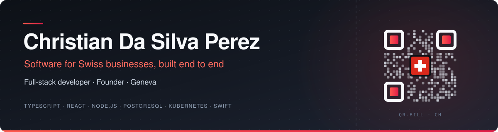

**Full-stack TypeScript · SaaS products · Mobile apps · Open-source tools**

<a href="https://www.linkedin.com/in/cdslvp/" title="LinkedIn profile"> LinkedIn</a>
&nbsp;·&nbsp;
<a href="mailto:c.dslvp@gmail.com" title="Email Christian"> Email</a>
&nbsp;·&nbsp;
<a href="https://tobill.ch" title="To Bill website"> tobill.ch</a>

## Building software for Swiss businesses

I'm **Christian Da Silva Perez**, a full-stack developer and founder based in **Geneva**. I build software products from the first line of code to production: APIs, web and mobile apps, and the infrastructure they run on.

I built **[To Bill](https://tobill.ch)**, invoicing and accounting software for Swiss SMEs.

> **Focus:** SaaS products, full-stack TypeScript, mobile apps, and tools that make developers faster.

## Selected work

<table>
<tr>
<td width="33%" valign="top">

SAAS · SWISS SMES

<h3>To Bill</h3>

<strong>Invoicing and accounting for Swiss SMEs.</strong>

Web, iOS and Android apps, built and run end to end.

<a href="https://tobill.ch" title="To Bill website"> Website</a>

</td>
<td width="33%" valign="top">

MACOS · SWIFTUI · OPEN SOURCE

<h3>Tack</h3>

<strong>A quick alternative to Notes.</strong>

Pin a thought from the macOS menu bar with one shortcut, even over full-screen apps. Checklists, reminders, tags and Markdown.

Free, MIT-licensed, no telemetry.

<a href="https://github.com/ryolay/tack" title="Tack source code on GitHub"> Code</a>
&nbsp;·&nbsp;
<a href="https://github.com/ryolay/tack/releases/latest" title="Download the latest Tack release"> Download</a>

</td>
<td width="33%" valign="top">

DEVELOPER TOOLS · OPEN SOURCE

<h3>Nebula</h3>

<strong>A free, open-source alternative to GitKraken.</strong>

A fast Git client for macOS, Windows and Linux: commit graph, merge conflicts, pull requests and an integrated terminal.

No subscription, no sign-up, no telemetry.

<a href="https://github.com/ryolay/nebula" title="Nebula source code on GitHub"> Code</a>
&nbsp;·&nbsp;
<a href="https://github.com/ryolay/nebula/releases" title="Download Nebula releases"> Download</a>

</td>
</tr>
</table>

## How I work

- **Correct before pretty.** Business software handles money, law and personal data; I get the rules right before I polish the screens.
- **Run it, don't just compile it.** Every change is exercised against a real stack before it ships; a clean type check is not proof.
- **Docs are part of the product.** A visible change ships with its user guide.
- **Own the whole stack.** From the database schema and background jobs to the mobile builds and the Kubernetes manifests.

## Technical toolkit

| Area | Methods & tools |
| :--- | :--- |
| **Front-end** | React, React Router, Vite, Tailwind CSS, Next.js |
| **Back-end** | Node.js, Fastify, Prisma, PostgreSQL, BullMQ & Redis, OpenAPI |
| **Mobile & desktop** | Expo (iOS & Android), Swift with SwiftUI & AppKit, Electron |
| **AI integration** | Model Context Protocol (MCP) servers, AI features over permissioned APIs |
| **Infrastructure** | Docker, Kubernetes, k3s, GitHub Actions, S3 object storage |

---

### Connect

Happy to talk about SaaS, product engineering or open-source tools.

<a href="https://www.linkedin.com/in/cdslvp/" title="LinkedIn profile"> LinkedIn</a>
&nbsp;·&nbsp;
<a href="mailto:c.dslvp@gmail.com" title="Email Christian"> Email</a>
&nbsp;·&nbsp;
<a href="https://tobill.ch" title="To Bill website"> tobill.ch</a>

Geneva, Switzerland

